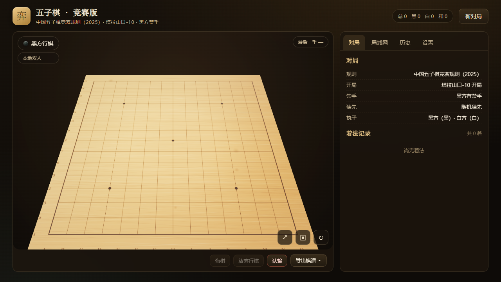

# 弈 · 五子棋竞赛版（GomokuPro）

一款遵循**中国五子棋竞赛规则（2025）**的 3D 五子棋应用：塔拉山口-10 开局、黑方禁手、玉石棋盘、可调难度人机对战与局域网联机。基于 Vue3 + TypeScript + three.js 构建，内置 Rapfi 引擎（WASM）并附带可独立分发的 Tauri 桌面客户端。

<p align="center">
  
</p>

- **3D 棋盘**：实木纹理棋盘 + 玉石质感棋子，支持鼠标旋转、平板触控（点击 / 拖拽 / 双指缩放）。
- **正规规则**：塔拉山口-10 / Swap2 / 自由开局，黑方三三、四四、长连禁手判定与提示。
- **五档 AI**：入门 → 地狱，Rapfi（WASM）主力搜索 + 自研 JS 引擎负责受限开局与兜底。
- **局域网对战**：同网段设备输入房间码即可开房对弈，支持同步、悔棋、再战。
- **桌面壳**：Tauri 客户端内置前端产物与联机服务，双击即用。
- **零外部资源**：背景音乐与音效全部由 Web Audio 实时合成，无版权素材。

## 快速开始

```bash
npm install        # 安装依赖
npm run dev        # 启动开发服 http://localhost:5173
```

浏览器打开 `http://localhost:5173`，默认进入「人机」页签即可对弈。

## 常用命令

| 命令 | 说明 |
| --- | --- |
| `npm run dev` | Vite 开发服，端口 5173（`host: true`，局域网可访问） |
| `npm run typecheck` | `vue-tsc --noEmit` 类型检查 |
| `npm run test` | `vitest run` 单元测试（Node 环境） |
| `npm run build` | 类型检查 + `vite build` → `dist/` |
| `npm run preview` | 预览构建产物 |
| `npm run server` | 独立局域网对战服务（WebSocket，端口 8787） |
| `npm run dev:all` | 同时启动 web 与联机服务 |
| `npm run app:dev` | Tauri 桌面壳开发模式（连接 5173） |
| `npm run app:build` | 打包 Tauri 客户端（先 `npm run build`） |

单文件测试：`npx vitest run src/core/rules/rules.test.ts`；单用例：`npx vitest run -t "关键字"`。

## 项目结构

```
gomoku/
├─ index.html            # 游戏应用入口（Vite）
├─ src/                  # 游戏前端源码
│  ├─ core/              # 纯逻辑：棋盘、坐标、规则引擎、AI、棋谱
│  │  ├─ rules/          # 规则引擎（开局状态机 / 禁手 / 连型）
│  │  └─ ai/             # Rapfi 客户端 + 自研搜索/评估 + worker
│  ├─ stores/            # Pinia：对局 / 设置 / 联机 / 历史
│  ├─ three/             # three.js 场景与程序化纹理
│  ├─ components/        # Vue 组件（棋盘、控制栏、各功能面板）
│  └─ audio/             # Web Audio 合成音乐与音效
├─ public/wasm/          # Rapfi WASM 运行时（已入库）
├─ server/index.mjs      # 独立局域网对战服务（Node 版）
├─ src-tauri/            # Tauri 桌面壳
│  ├─ src/lib.rs         # 8080 静态托管 + 8787 联机服务
│  └─ manager/           # 桌面窗口 UI（服务管理器）
└─ docs/ARCHITECTURE.md  # 架构设计文档
```

## 技术栈

Vue 3 · TypeScript · Vite · Pinia · three.js · Vitest · Tauri 2（Rust / axum）· Rapfi（Emscripten → WASM）

## 规则

- **棋盘**：15×15，天元 H8。术语与坐标遵循竞赛记谱（列 A–O，行 1–15）。
- **开局**：默认「塔拉山口-10」——开局 6 手受区域限制，前 5 手对手可选择交换；亦可选 Swap2 或自由开局。
- **禁手**：黑方三三、四四、长连判负（自由开局可关闭）。
- **终局**：五连、禁手、认输、超时、违规等，支持双方和棋。

## 人机对战

五档难度对应不同搜索深度、候选数与容错率；主力引擎为 Rapfi 的 WASM 版本，在受限开局（需在指定区域/给点集合中落子）以及引擎不可用时自动回退到自研 JS 引擎，二者由 worker 线程运行以避免阻塞界面。

## 局域网对战

1. 在主机上启动联机服务：`npm run server`（或使用桌面客户端自带的服务）。
2. 一台设备创建房间得到 4 位房间码，另一台输入房间码加入。
3. 房主开局并同步棋局，双方走子实时同步，支持悔棋请求与再来一局。

服务默认监听 `ws://<主机>:8787`，可在设置中自定义地址。

## 桌面客户端（Tauri）

```bash
npm run app:build      # 产出 exe 与 NSIS 安装包
```

客户端启动后在 **8080** 端口托管内置前端、在 **8787** 端口运行联机服务，同局域网设备可用浏览器访问 `http://<主机>:8080` 直接加入对局。窗口 UI 提供服务启停与地址展示。

> 前端产物在编译期被内嵌进 exe，因此修改 `src/` 后必须重新执行 `npm run app:build` 才会在客户端中生效。

## 许可

本项目以 **GNU General Public License v3.0** 发布，全文见 [LICENSE](./LICENSE)；中文（非官方）译本见 [LICENSE.zh-CN.md](./LICENSE.zh-CN.md)（仅供理解，法律效力以英文原文为准）。

之所以采用 GPL-3.0：本项目分发内嵌了 [Rapfi](https://github.com/dotb1ue/rapfi)（GPL-3.0）的编译产物 `public/wasm/rapfi.wasm`。按 GPL 的传染性要求，对外分发包含该组件的整体作品时须以 GPL-3.0 授权并提供对应源码。若你仅在本机自用、不对外分发，则不受此限；届时可将本项目改为其他许可（请同时移除或替换 Rapfi 组件以符合各许可条款）。

Copyright (C) 2026 GomokuPro 贡献者。

## 文档

- 架构与设计说明：[docs/ARCHITECTURE.md](./docs/ARCHITECTURE.md)
- 面向 AI 编码代理的仓库说明：[AGENTS.md](./AGENTS.md)
