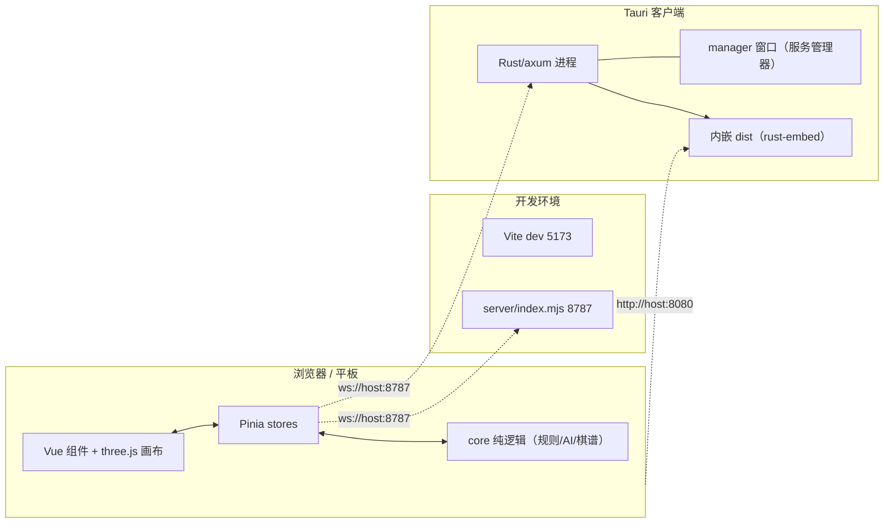
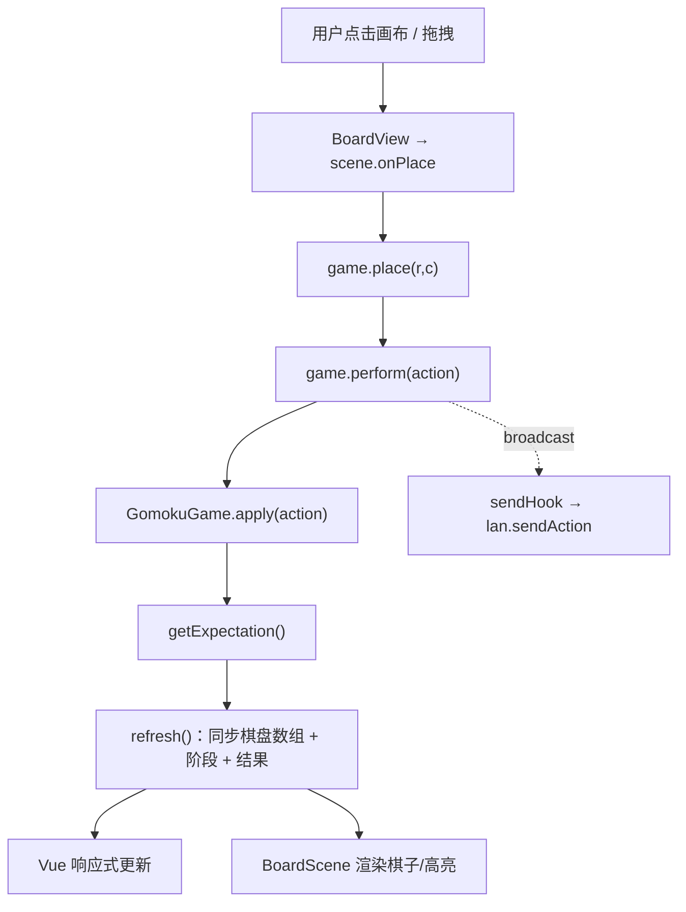
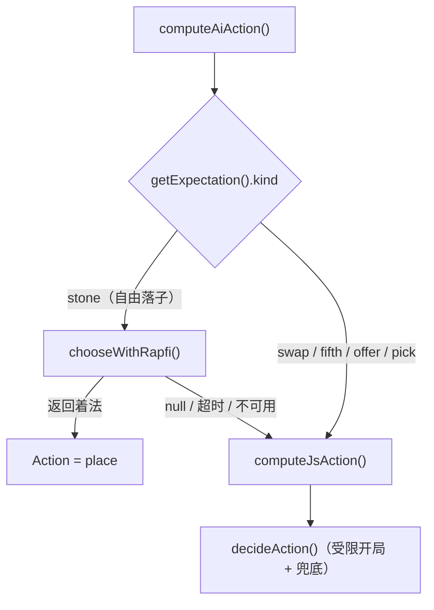
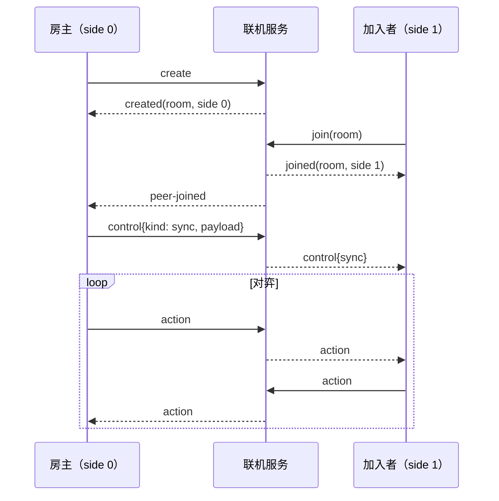
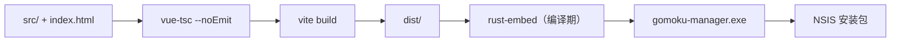

# 架构设计 · 弈 · 五子棋竞赛版

本文描述 GomokuPro 的整体结构、模块职责与关键设计取舍。术语与规则细节见 [README](../README.md)，面向编码代理的精简说明见 [AGENTS.md](../AGENTS.md)。

## 1. 总览

项目由**四个可独立运行的部分**组成，共享同一套 `src/` 前端源码：

| 部分 | 入口 | 运行形态 | 端口 |
| --- | --- | --- | --- |
| 游戏前端 | `index.html` + `src/` | 浏览器 / WebView | Vite 5173（dev） |
| 联机服务（开发版） | `server/index.mjs` | 独立 Node 进程 | 8787 |
| 桌面客户端 | `src-tauri/` | Tauri 应用（Rust） | 8080（静态）+ 8787（联机） |
| 桌面窗口 UI | `src-tauri/manager/` | Tauri 内嵌页面 | — |

设计目标：**核心逻辑与渲染/平台解耦**——规则引擎、AI、棋谱、坐标全部是纯 TypeScript（无 DOM 依赖），既便于单元测试，也能同时服务于浏览器与桌面壳。

## 2. 运行时拓扑



要点：
- 浏览器与桌面壳的**前端完全一致**，区别仅在于联机服务由谁提供（Node 版 vs Rust 版）与静态资源由谁托管。
- 两套联机服务**协议相同**（见 §9），因此可互换。

## 3. 代码分层

```
src/
├─ core/                  纯逻辑，无 Vue / DOM 依赖
│  ├─ types.ts            领域类型：Color / Cell / Point / Move / Phase / GameResult ...
│  ├─ constants.ts        棋盘尺寸、黑白常量、星位、方向、withinSquare
│  ├─ board.ts            Board：15×15 棋盘模型（get/isEmpty/*）
│  ├─ coords.ts           坐标转换：colLetter / toLabel / fromLabel（H8 ↔ r7,c7）
│  ├─ record.ts           棋谱导出：exportSGF / exportJSON / exportText + 文案标签
│  ├─ rules/              规则引擎（见 §5）
│  │  ├─ engine.ts        GomokuGame：开局状态机 + apply/undo + 胜负判定
│  │  ├─ shapes.ts        连型分析：contiguousRun / analyzeDirection / analyzePoint / findFive / findOverline
│  │  ├─ forbidden.ts     禁手：checkForbidden / scanForbiddenPoints
│  │  └─ analyze.ts       威胁点：findWinningPoints / findLiveFourPoints
│  └─ ai/                 AI（见 §6）
│     ├─ levels.ts        五档难度参数
│     ├─ evaluate.ts      局面评估 / 候选点排序 / 胜负与禁手速判
│     ├─ search.ts        迭代加深 + alpha-beta 搜索（chooseMove）
│     ├─ decide.ts        按 Expectation 产出 Action（含开局决策）
│     ├─ rapfi.ts         Rapfi WASM 客户端（worker 通信 + 合法性校验）
│     ├─ ai.worker.ts     自研 JS 引擎的 worker 入口
│     └─ index.ts         统一再导出
├─ stores/                Pinia（状态与编排）
│  ├─ game.ts             对局中心：落子/悔棋/重开/AI 调度/联机钩子
│  ├─ settings.ts         设置持久化（localStorage: gomoku.settings.v1）
│  ├─ lan.ts              局域网联机客户端（WebSocket）
│  └─ history.ts          对局历史（localStorage: gomoku.history.v1）
├─ three/                 渲染层
│  ├─ scene.ts            BoardScene：渲染器 / 相机 / 光照 / 棋子 / 交互
│  └─ textures.ts         程序化纹理：棋盘 / 玉石 / 木纹 + 木色主题
├─ components/            Vue 组件
│  ├─ BoardView.vue       棋盘容器（挂载 3D 场景）
│  ├─ ControlBar.vue      操作栏（落子/交换/悔棋/重开等）
│  └─ Panel{Game,Ai,Lan,History,Settings}.vue  功能面板
├─ audio/                 Web Audio
│  ├─ music.ts            生成式背景音乐（4 首） + 卷积混响
│  └─ sfx.ts              音效（落子/胜负等） + unlockAudio
├─ App.vue                布局与页签
└─ main.ts                应用入口（挂载 Pinia + App）
```

分层约束：
- `core/` 不引入 Vue / three.js / DOM，保证可测试、可复用。
- `stores/` 是唯一的状态真相源；组件只读写 store。
- `three/` 只负责把 `Board` 状态画出来并通过回调上报交互，不持有对局规则。

## 4. 前端数据流

对局采用**单一「动作日志 + 重放」模型**：状态由 `GameOptions` + `Action[]` 完全决定，任何时刻都能从零重放到当前局面。这使悔棋、联机同步、历史复盘共用同一条路径。



- `perform(action, broadcast)` 是唯一入口：执行 → 刷新 → （AI 模式下）触发 `maybeAiMove` → （联机模式下）广播。
- `refresh()` 从引擎读取棋盘数组、当前期望、阶段与结果，写入 store，供视图订阅。
- 联机时 `game.setSendHook(fn)` 注入发送回调，房主在对手加入时用 `syncPayload()` 下发完整局面。

## 5. 规则引擎

`core/rules/engine.ts` 的 `GomokuGame` 是规则核心。它同时是**开局状态机**与**终局裁判**。

### 5.1 数据模型

- `GameOptions { mode, forbidden?, firstSide? }`：`mode ∈ {tara-10, swap2, free}`。
- `Expectation`：引擎向外部声明的「下一步需要什么输入」，共 6 种：

| kind | 含义 | 关键字段 |
| --- | --- | --- |
| `stone` | 在棋盘落子 | `size`（限制区域边长；`null` 表示任意） |
| `swap` | 是否交换执子 | `side` / `color` |
| `fifth-mode` | 第五手选择打数 | 黑方决策 |
| `offer` | 给出若干候选点 | `size` / `count` |
| `pick` | 从候选点中选一 | `options` |
| `end` | 对局结束 | — |

- `Action`：与 Expectation 对应的输入，含 `place / swap / noswap / extend / fifth-single / fifth-ten / offer / pick / pass / resign`。

### 5.2 塔拉山口-10 状态机

- `TARA_ZONE = [1,3,5,7,9,0]`：开局第 1–6 手的允许区域边长（0 = 不限），配合 `withinSquare`（以天元为中心的方框）约束落子。
- `TARA_SWAP_AFTER = [true×5]`：前 5 手落子后对手拥有交换权（`pendingSwap` → `Expectation.kind='swap'`）。
- 第 4 手后进入第五手选择（`fifth-mode`：单五打 / 十打）；十打时黑方 `offer` 10 个候选点，白方 `pick` 其一。
- 满 6 子后开局结束，转入 `stone` 自由落子。
- Swap2 使用独立阶段机：`place3 → choose → extend → choose2 → done`。

### 5.3 胜负与禁手

- 落子后由 `shapes.ts` 沿四个方向分析连型（`analyzePoint` / `findFive` / `findOverline`）。
- 五连即胜；黑方命中禁手（三三 / 四四 / 长连，`checkForbidden`）判负。
- 结果封装为 `GameResult`（`win`：五连/禁手/认输/超时/违规；`draw`：和棋/双弃/满盘/双方超时）。
- 每次 `apply` 前压入 `Snapshot`，`undo()` 弹栈恢复，天然支持悔棋与重放。

## 6. AI 架构

人机对战走**双引擎**策略，由 `stores/game.ts` 的 `computeAiAction()` 编排：



- **Rapfi（WASM）**：主力引擎。`rapfi.ts` 在 worker 中加载 `public/wasm/rapfi.js` + `rapfi.wasm`，通过 `postMessage` 发送棋子列表与时间/深度/内存预算，取回着法并做合法性校验（空位、在框内）。仅在 `Expectation.kind === 'stone'` 且 `size === null`（自由落子）时启用；不可用或非法时返回 `null` 触发回退。
- **自研 JS 引擎**：负责 Rapfi 不覆盖的场景——受限开局（需在指定区域/候选集合内决策，`decide.ts`）以及 Rapfi 不可用时的兜底（`search.ts` 的迭代加深 + alpha-beta，`evaluate.ts` 的局面评估）。运行在 `ai.worker.ts` 中。
- **难度**：`levels.ts` 用参数刻画五档，`blunder`（概率性漏防）与 `random`（候选随机）用于制造弱侧失误，`depth/candidates` 控制搜索强度，`budgetMs/maxDepth` 是 Rapfi 预算。

### 6.1 取消与超时

- `cancelAi()`：以自增 `aiToken` 作废在途结果并复位 `aiThinking`，在重开 / 悔棋 / 重放 / 退出人机时调用，避免「思考中卡死」。
- JS 引擎经 `postMessage` 传 JSON 深拷贝参数（规避 `DataCloneError`），并设 15s 超时；Rapfi 请求带 `timeoutMs + 2s` 兜底。
- `maybeAiMove()` 有 `applied` 守卫，确保过期结果不会二次落子。

## 7. 3D 渲染

- `three/scene.ts` 的 `BoardScene` 封装 `WebGLRenderer` / `PerspectiveCamera` / `OrbitControls` / `RoomEnvironment` 光照，管理棋盘分组、棋子网格（`stones: Map`）与落子动画。
- 交互：射线拾取映射到棋盘坐标；支持鼠标旋转、平板触控（点击 / 拖拽 / 双指缩放）；移动端用「悬停幽灵子」与点击确认避免误落子。
- `three/textures.ts` 用 Canvas 程序化生成棋盘木纹、玉石棋子、纯木底纹，并提供 `classic / walnut / dark` 三套木色（`woodPalette`）。
- 渲染层与规则层通过回调解耦：`SceneCallbacks.onPlace/onHover` 上报，`BoardView.vue` 转交 store。

> 已知平台约束：**不要为画布祖先或覆盖层添加 `backdrop-filter`**，在 Tauri 的 WebView2 下会导致 WebGL 画布整块闪黑。

## 8. 音频

- `audio/music.ts` 的 `MusicPlayer` 使用 Web Audio **实时合成**背景音乐（`TRACKS` 4 首东方氛围曲，含音阶、拨弦/铺底与卷积混响），不依赖任何音频文件。
- `audio/sfx.ts` 提供落子/胜负等音效，`unlockAudio()` 处理浏览器自动播放策略。

## 9. 联机协议

WebSocket + JSON，服务端仅做**房间管理与消息转发**，不懂规则；规则判定完全在各自前端。房间为 2 人（side 0 = 房主 / side 1 = 加入者）。

### 9.1 消息类型

| 方向 | `t` | 说明 |
| --- | --- | --- |
| C→S | `create` | 创建房间 |
| C→S | `join` | 以 `room` 码加入 |
| C→S | `action` | 转发一手 `action` |
| C→S | `control` | 控制类消息（同步/悔棋/再战） |
| C→S | `ping` | 心跳 |
| S→C | `created` | 返回房间码与 side |
| S→C | `joined` | 加入成功 |
| S→C | `peer-joined` / `peer-left` | 对手进出 |
| S→C | `action` / `control` | 来自对手的转发 |
| S→C | `error` / `pong` | 错误 / 心跳回应 |

`control.kind`：`sync`（房主下发 `{opts, actions}`）、`undo-request` / `undo-accept` / `undo-decline`、`rematch-request` / `rematch-accept`。

### 9.2 典型流程



- 服务端实现两套：`server/index.mjs`（Node `ws`，开发用）与 `src-tauri/src/lib.rs` 的 axum 版本（客户端内置），协议一致。
- 客户端地址优先取设置的 `lanUrl`，否则默认 `ws://<当前主机>:8787`。

## 10. 桌面壳（Tauri 2）

`src-tauri/src/lib.rs` 在启动时并行拉起两个服务：

- **HTTP 8080**：`rust-embed` 把前端 `dist/` **编译期内嵌**进 exe，`serve_asset` 命中即返回，未命中回退 `index.html`（SPA）。
- **WebSocket 8787**：`LanHub` 维护连接与房间（`next_id` / `conns` / `rooms`），逻辑与 `server/index.mjs` 对齐。

窗口 UI 位于 `src-tauri/manager/index.html`（**不经 Vite 构建**，由 `tauri.conf.json` 的 `frontendDist: "./manager"` 直接内嵌），通过 Tauri 命令控制服务并展示地址：

| 命令 | 作用 |
| --- | --- |
| `get_status` | 返回 HTTP/LAN 运行状态与端口、本机地址 |
| `start_lan` / `stop_lan` | 启停 8787 服务 |
| `open_browser` | 用系统浏览器打开 http(s) 地址 |

服务用 `tokio_util::sync::CancellationToken` 优雅关闭；状态变化经 `lan-status` 事件广播给窗口。

## 11. 构建与部署



- `npm run build` = 类型检查 + `vite build`；`npm run app:build`（`tauri build`）会先执行 `beforeBuildCommand: "npm run build"`。
- **陷阱**：`dist/` 在 Rust 编译期内嵌，改动 `src/` 后必须重新打包才在客户端生效；且打包前须先关闭正在运行的 `gomoku-manager.exe`，否则链接因文件占用失败（`os error 5`）。
- 别名 `@ → src` 由 `vite.config.ts` 与 `tsconfig.json` 同步配置。

## 12. 测试

- 框架 Vitest，`environment: 'node'`（无 DOM），仅收集 `src/**/*.test.ts`；因此**只测纯逻辑**（规则引擎、AI），无法测 Vue 组件。
- 现有测试：`src/core/rules/rules.test.ts`、`src/core/rules/engine.test.ts`、`src/core/ai/ai.test.ts`。
- 质量门：`vue-tsc --noEmit` 类型检查（`strict` + `noUnusedLocals/Parameters`）与单元测试；仓库**未配置 ESLint / Prettier**。

## 13. 关键约束与陷阱

- 棋盘 15×15；`r=0` 最下、`c=0` 最左 A 列；天元 H8 = (r7,c7)；`BLACK=1`/`WHITE=2`。
- 规则逻辑集中在 `core/`，改动规则务必同步/新增测试。
- Rapfi 产物 `public/wasm/` 为运行时硬依赖（已入库），其 Emscripten 工具链不在仓库内。
- 联机服务不做规则校验，安全性依赖双方前端一致；仅适用于可信局域网。
- 渲染约束见 §7（WebView2 与 `backdrop-filter`）。
